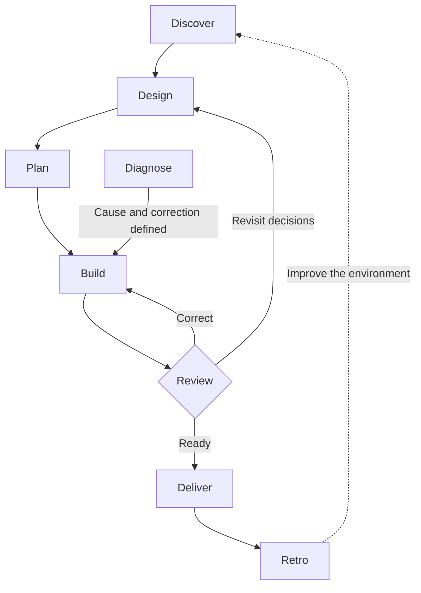

# Keystone Core · v0.2

Reusable enterprise development skills for GitHub Copilot in VS Code.

**Keystone** is the central piece that holds an arch together. Here, it represents a shared engineering method connecting existing agents across technology stacks.

The first skill, **Keystone Discover**, turns a request into a clearly defined change.

## Skills

| Skill | Purpose | Main output |
|---|---|---|
| [`keystone-discover`](.github/skills/keystone-discover/SKILL.md) | Understand a request | Change brief and unresolved decisions |
| [`keystone-design`](.github/skills/keystone-design/SKILL.md) | Design the solution | Contracts, decisions and validation strategy |
| [`keystone-plan`](.github/skills/keystone-plan/SKILL.md) | Specify and break down work | Specification and tasks with dependencies |
| [`keystone-build`](.github/skills/keystone-build/SKILL.md) | Implement a task | Verifiable change and test evidence |
| [`keystone-review`](.github/skills/keystone-review/SKILL.md) | Review a change | Separate specification and standards findings |
| [`keystone-deliver`](.github/skills/keystone-deliver/SKILL.md) | Prepare delivery | Readiness assessment and delivery procedure |
| [`keystone-retro`](.github/skills/keystone-retro/SKILL.md) | Improve the working environment | Evidence-based improvement proposals |
| [`keystone-diagnose`](.github/skills/keystone-diagnose/SKILL.md) | Investigate a defect | Reproduction, tested cause and correction plan |

## Use in VS Code

1. Preview and apply installation with [the optional installer](tools/install.mjs), or copy `.github/skills/` and `.github/keystone/` together after reviewing existing differences. Existing agents and instructions are preserved; conflicting files require a manual merge.
2. Confirm that Copilot discovers all eight skills in VS Code's skill configuration. Discovery makes a skill available; it does not guarantee invocation for every relevant request.
3. Start with `/keystone-discover` followed by the request. For multi-phase work, retain its change record through the [workflow contract](.github/keystone/workflow.md). Existing agents may also select a relevant skill while carrying out a requested activity.
4. Review the handoff and choose the next activity. Skills do not automatically advance the workflow.

Keep both folders together so relative references resolve. The package adds no agents, extensions or external services.

Format and supported locations: [VS Code Agent Skills documentation](https://code.visualstudio.com/docs/agent-customization/agent-skills).

Follow [VS_CODE.md](VS_CODE.md) for installation, existing-agent pointers, module onboarding, phase invocations and resumption. The skills can run without the helper scripts; the optional installer needs Node.js 18+ and Git.

## Connect existing agents

Keep each agent's role, tools, permissions and technical specialization. Add a conditional reference to the skill appropriate to its work. For example, an implementation agent in `.github/agents/` can reference `../skills/keystone-build/SKILL.md` when implementing a defined task. A reviewer can reference `keystone-review` for review requests.

Confirm skill loading and execution with a real task. Skills operate within existing authorization; actual permission enforcement belongs to the host and project controls. The user chooses transitions between activities; the agent can work autonomously within the requested activity.

## Technical context

Every skill reads the shared [context contract](.github/keystone/context.md). Record pointers to project sources in [project-context.md](.github/keystone/project-context.md), or link the team's existing documentation there.

Select context by module: language, framework, workload, repository procedures and applicable policies. Changes across modules also require shared contracts and integration evidence.

This version provides common methods. Technical profiles, executable adapters and bank policies must come from actual projects. Validation across every stack is not implied.

Use the [module profile template](.github/keystone/templates/module-profile.md) only where existing sources need a navigation map. The [change record template](.github/keystone/templates/change-record.md) retains requirements, task/dependency mappings, criterion evidence, review and delivery references. It supports a fresh chat without assuming previous chat history.

## GitHub workflow

GitHub is the team's source code platform, with issues and branches available. The [GitHub workflow reference](.github/keystone/github.md) defines how existing agents can use these artifacts without changing their technical specialization.

| Activity | GitHub artifacts |
|---|---|
| Discover and Design | Read an existing issue; retain agreed scope and linked decisions |
| Plan | Draft or publish issue specifications and tasks; record hierarchy and dependencies |
| Build | Reuse or create a task branch; implement and validate; prepare or publish a linked PR when requested |
| Review | Evaluate the exact PR state against issue criteria, standards and check evidence |
| Deliver | Follow integration and delivery controls; distinguish merged from deployed work |
| Diagnose and Retro | Use existing issue, code and check evidence; publish updates when requested |

For a small change, the suggested route is **issue → task branch → pull request → checks and review → merge → delivery verification**. Larger initiatives can use parent and task issues and the project's integration strategy. The user still chooses transitions between activities.

The reference uses actual repository templates, branching conventions and tools. Host, repository names, default and integration branches, access and check requirements remain to be supplied or discovered in a target project. Source code management through GitHub does not require changing the team's CI or deployment system.

The package documents these procedures; it has not been connected to the bank's GitHub installation or used to create remote artifacts.

## Workflow

These are possible routes. A small task can carry its design and specification in one ticket. An investigation can end with findings and open questions. Diagnose a defect before choosing its correction.

## Status and notices

Ready for a guided pilot. [Verification](VERIFICATION.md) separates package/installation checks from live Copilot and GitHub behavior. [PILOT.md](PILOT.md) defines the end-to-end acceptance scenarios; live validation is deferred by the user.

Run [the package validator](tools/validate-pack.mjs) for structural/reference checks. [Installer integration tests](tests/install.test.mjs) exercise preservation, conflicts, idempotency and linked destinations in isolated local repositories. These tests do not execute the development phases or establish an enterprise security pass.

The previous security assessment applies to v0.1. This release adds installation helpers and changes instruction behavior, so it is a new review scope.

Source attribution and adaptation history are kept separately in [third-party notices](THIRD-PARTY-NOTICES.md), outside the skill definitions. The original license is included in [LICENSE.mattpocock](LICENSE.mattpocock).
